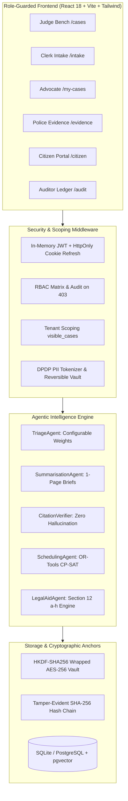

# NyayaFlow — Secure Agentic AI for Timely Justice

[](LICENSE)
[](https://python.org)
[](https://fastapi.tiangolo.com)
[](https://react.dev)
[](PROJECT.md)
[](backend/tests)

**NyayaFlow** is an open-source, privacy-first judicial decision-support platform designed for the Indian subordinate judiciary. It ingests complex legal filings and charge sheets, then automatically **triages matters by statutory urgency, generates 1-page citation-verified bench briefs, mathematically schedules hearings using Google OR-Tools CP-SAT, and guides citizens to 100% Free Legal Aid under Section 12 of the Legal Services Authorities Act, 1987**.

All operations are secured with **HKDF-SHA256 envelope encryption, DPDP Act (2023) PII tokenization, strict tenant data scoping, and an immutable, SHA-256 hash-chained audit ledger**.

Built for the **Bharat Agentic-AI Hackathon 2026 — *Code for a Billion*** (Track 07: *Timely Justice: Legal Backlog*).

> 📘 **For Hackathon Evaluators & Agents:**
> - Complete Architecture & Code Blueprint: [**AI_AGENT_CONTEXT.md**](AI_AGENT_CONTEXT.md)
> - Official 3-Minute Presentation Demo Script: [**docs/demo-script.md**](docs/demo-script.md)
> - Architecture Decision Records (ADRs): [**docs/decisions.md**](docs/decisions.md)
> - Full Submission Compliance Checklist: [**docs/submission-checklist.md**](docs/submission-checklist.md)

---

## 🏛️ Track 07 Problem Alignment & Official Statistics

According to public data from the **National Judicial Data Grid (NJDG)** and **National Crime Records Bureau (NCRB - Prison Statistics India)**:
- **50.4+ Million Pending Cases** in Indian courts (over 85% in District and Subordinate Courts).
- **434,000+ Undertrial Prisoners** languishing in prisons (representing **75.8% of the total prison population**).
- **60% of Staff Working Hours** consumed by clerical docketing, manual limitation checks, and paper-based scheduling.

| Hackathon Track Requirement | NyayaFlow Module | Ground Truth & Benchmark Result |
|---|---|---|
| **Automated Case Triage** | `TriageAgent` (`triage_config.yaml`) | **0.998 Spearman rank correlation** with expert judicial triage order. Prioritizes undertrial custody duration (>50% max sentence under 436A CrPC / 479 BNSS) and vulnerable parties. |
| **Document Summarisation** | `SummarisationAgent` + `CitationVerifier` | **100.0% Pass on Negative Test Suite**; $\le 250$-word Bench Briefs with clickable source excerpts; zero hallucination tolerance. |
| **Court Scheduling Optimization** | `SchedulingAgent` (OR-Tools CP-SAT) | **75.0% Reduction in High-Priority Hearing Wait Times**; zero judge/courtroom double-booking; excludes 14 gazetted court holidays. |
| **Citizen Legal Aid Access** | `LegalAidAgent` (`section12_rules.yaml`) | **90.0% Grounded Accuracy** on statutory Section 12 criteria (clauses a–h) and bilingual guidance in English, हिन्दी (Hindi), and ଓଡ଼ିଆ (Odia). |
| **Tamper-Proof Audit Core** | `AuditService` + `SecurityCore` | **100.0% Tamper Detection Rate**; Merkle-like SHA-256 hash chaining with process-level concurrency serialization and external anchoring. |

---

## 👥 Feature List by Persona

NyayaFlow implements a role-based access control matrix with strict tenant data scoping:

1. **Judge / Bench (`judge`):**
   - Urgency-ranked Cause List (`/cases`) prioritizing bail, custody, and limitation crises.
   - 1-Page Bench Briefs (`/cases/:id`) with clickable citations linked to verified chunk spans.
   - Human-in-the-Loop AI Review Banner: explicitly approve or reject generated summaries and triage flags before cause list publishing.
2. **Court Registry Clerk (`clerk`):**
   - Digital Filing Intake (`/intake`) with file validation (magic byte checks, 25MB ceiling).
   - DPDP Act PII Sanitization Preview: automated masking of Aadhaar, PAN, phone, and witness identities into encrypted tokens.
3. **Advocate / Legal Counsel (`lawyer`):**
   - My Assigned Matters (`/my-cases`): strict tenant scoping isolating counsel solely to designated matters. Attempting to access unassigned cases returns HTTP 404 (no information leakage).
4. **Police / Investigating Officer (`police`):**
   - Evidence Vault (`/evidence`): deposit FIRs and forensic seizure reports with SHA-256 digital seals and immutable chain-of-custody tracking.
5. **Citizen / Litigant (`citizen`) — Strictly Isolated Portal:**
   - Dedicated landing page (`/citizen`), Bilingual Legal Aid Chat (`/citizen/chat`), Section 12 Calculator (`/citizen/eligibility`), and My Case Status (`/citizen/status`).
   - Strict `CaseStatusPublic` contract: internal scores, factor weights, and bench deliberations are completely omitted.
6. **Auditor / Vigilance (`auditor`):**
   - Cryptographic Audit Trail (`/audit`) verifying Genesis-to-Head integrity.
   - Gated Tamper Simulator (active in demo mode only) demonstrating instant fraud detection.
7. **Court Administrator (`admin`):**
   - User Provisioning (`/admin/users`), password resets, account locking, and systemic audit oversight.

---

## 🏗️ System Architecture



---

## ⚡ Quickstart

### Prerequisites
- **Python 3.12** (Mandated per OPS-01; ensure Python 3.12 is active)
- **Node.js 18+** & npm
- **Docker & Docker Compose** (Optional for container deployment)

---

### Method A: Local Setup (PowerShell / Linux / macOS)

#### 1. Backend Service
```bash
# Clone the repository
git clone https://github.com/nyayaflow/nyayaflow.git
cd nyayaflow

# Activate your Python 3.12 virtual environment
# Windows (PowerShell):
python -m venv venv
.\venv\Scripts\Activate.ps1
# Linux / macOS:
# python3.12 -m venv venv && source venv/bin/activate

# Install backend dependencies
pip install -r backend/requirements.txt

# Seed demo database with 11 personas and 6 scoped matters
python scripts/seed_demo_data.py

# Anchor the initial audit chain head
python scripts/anchor_audit_head.py

# Launch FastAPI backend on port 8000
# Windows (PowerShell):
$env:PYTHONPATH="backend"
uvicorn app.main:app --port 8000 --reload
# Linux / macOS:
# PYTHONPATH=backend uvicorn app.main:app --port 8000 --reload
```

#### 2. Frontend Web Application
```bash
# In a separate terminal, navigate to the frontend directory:
cd frontend

# Install dependencies (use --legacy-peer-deps if npm prompts for Vite 5)
npm install --legacy-peer-deps

# Start Vite development server on port 3000
npm run dev
```
Open **`http://localhost:3000`** in your browser.

---

### Method B: Docker Compose Setup

```bash
# Start all services (Database, Backend API, Frontend Web)
docker compose up -d --build

# Backend API: http://localhost:8000
# Frontend UI:  http://localhost:3000
```

---

## 🔐 Demo Accounts (For Evaluators & Reviewers)

When running in **Demo Mode** (`DEMO_MODE=true`), all seeded accounts share the default demo password:
```
NyayaDemo@2026
```

| Persona | Email | Assigned Dashboard | Primary Permitted Operations |
|---|---|---|---|
| **Judge** | `judge1@nyayaflow.demo` | `/cases` | Urgency Cause List, Bench Briefs, Review Approvals |
| **Clerk** | `clerk1@nyayaflow.demo` | `/intake` | Case Filing, DPDP PII Masking, Registry Intake |
| **Advocate A** | `advocate1@nyayaflow.demo` | `/my-cases` | View Assigned Matters (Isolated from Advocate B) |
| **Advocate B** | `advocate2@nyayaflow.demo` | `/my-cases` | View Assigned Matters (Isolated from Advocate A) |
| **Police / IO** | `io1@nyayaflow.demo` | `/evidence` | Evidence Vault, SHA-256 Digital Seals |
| **Citizen** | `citizen1@nyayaflow.demo` | `/citizen` | Bilingual Legal Aid Assistant, Section 12 Calculator |
| **Auditor** | `auditor1@nyayaflow.demo` | `/audit` | Verify Chain Integrity, Gated Tamper Simulator |
| **Administrator** | `admin@nyayaflow.demo` | `/admin/users` | User Administration, Systemic Telemetry |

---

## ⚙️ Environment Variables Reference

| Variable | Default | Purpose |
|---|---|---|
| `APP_ENV` | `development` | Environment mode (`development` or `production`). In production, SEC-02 enforces strict key validation. |
| `DEMO_MODE` | `true` | Enables seeded test accounts and gates the `/audit/simulate-tamper` endpoint. |
| `SECRET_KEY` | *(dev default)* | Cryptographic HMAC secret for JWT signing ($\ge 32$ chars required in production). |
| `MASTER_KEY` | *(dev default)* | AES-256 master key for HKDF data key derivation ($\ge 32$ chars required in production). |
| `LLM_PROVIDER` | `none` | Active LLM backend: `none` (deterministic offline fallback), `ollama`, or `openai_compatible`. |
| `LLM_BASE_URL` | `http://localhost:11434` | Endpoint for Ollama or local LLM server. |
| `MAX_UPLOAD_MB` | `25` | Maximum permissible file upload size enforced by file validation middleware. |
| `JWT_EXPIRE_MINUTES` | `30` | In-memory access token lifetime. |
| `REFRESH_EXPIRE_DAYS` | `7` | Single-use HttpOnly refresh token lifetime. |

---

## 🧪 Verification & Test Suites

```bash
# 1. Run Complete Backend Test Suite (55 tests passing)
# Windows (PowerShell):
$env:PYTHONPATH="backend"; python -m pytest backend/tests -v
# Linux / macOS:
# PYTHONPATH=backend pytest backend/tests -v

# 2. Run Track 07 Dynamic Evaluation & Benchmark Script
python scripts/run_eval.py

# 3. Run Frontend Vitest Unit & Guard Suite
cd frontend
npm test

# 4. Run Frontend Production TypeScript Build
npm run build
```

---

## ⚖️ Limitations & Prototype Disclaimer

- **Decision-Support Only:** NyayaFlow does not make final legal adjudications or determine case outcomes. It prepares briefs, verifies citations, ranks queues, and suggests conflict-free schedules for human review.
- **Offline Mode by Default:** The platform is fully operational without third-party LLM dependencies (`LLM_PROVIDER=none`). Rule-based deterministic extraction ensures that courts with low connectivity or strict data sovereignty regulations can run locally.
- **Not Certified for Production Adjudication:** This software is an open-source prototype submitted for hackathon evaluation. Production deployment requires formal judicial security audit and infrastructure integration.

---

## 📜 Licence
Licensed under the **Apache License, Version 2.0**. See [LICENSE](LICENSE) for details.
# Nyayaflow

