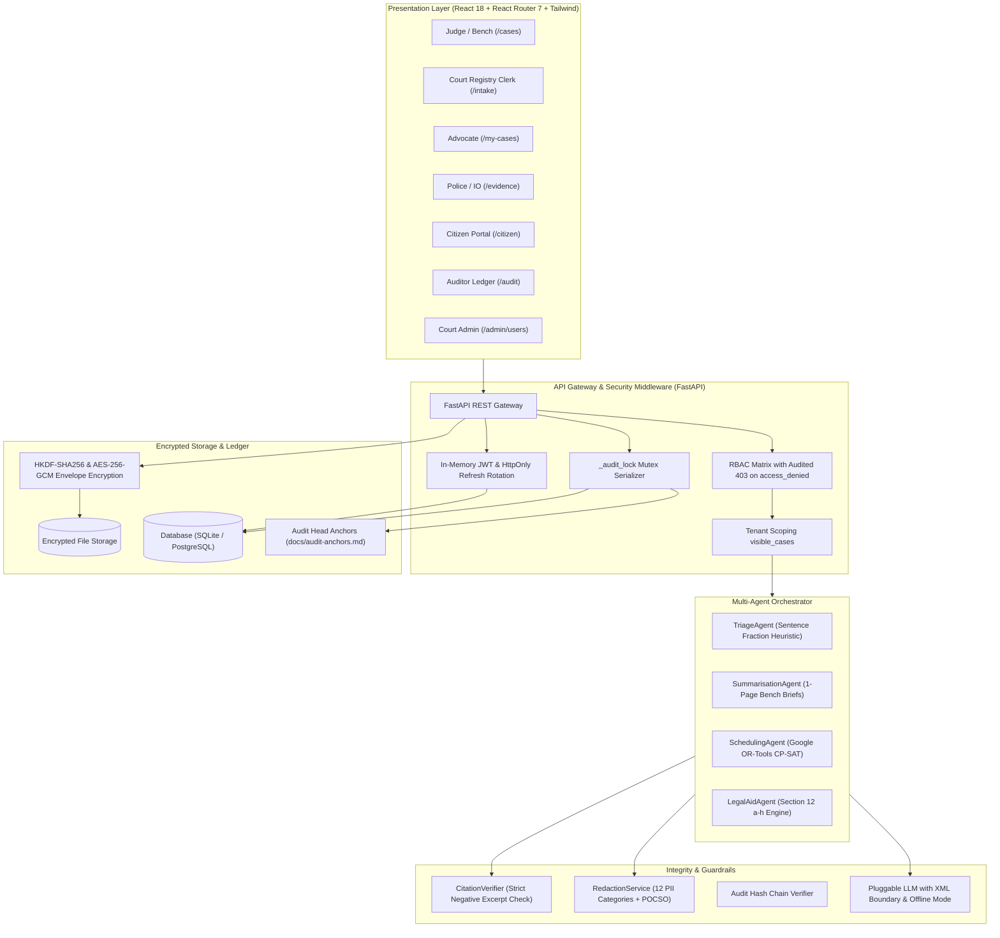

# NyayaFlow — System Architecture & Multi-Agent Specifications

## 1. High-Level System Architecture

NyayaFlow is built on two interdependent layers designed for strict judicial integrity and operational acceleration:

---

## 2. Multi-Agent Pipeline Specifications

1. **Intake Agent (`IntakeAgent`):**
   - Validates incoming filings for size ($\le 25\text{MB}$), MIME type, and magic bytes.
   - Masks 12 statutory PII categories into reversible encrypted tokens.
   - Classifies document types and extracts statutory offenses (BNS, IPC, CrPC, BNSS, NDPS, POCSO).

2. **Triage Agent (`TriageAgent`):**
   - Implements configurable weights from `backend/app/agents/triage_config.yaml`.
   - Computes transparent urgency scores ($0\text{--}100$) prioritizing under-trial custody duration (>50% max sentence under Section 436A CrPC / 479 BNSS: +35 points), limitation deadlines (<7 days: +25 points), and vulnerable parties (+20 points).
   - Classifies matters into 4 triage tiers: *Critical*, *High*, *Medium*, and *Standard*.

3. **Summarisation Agent (`SummarisationAgent`):**
   - Generates concise 1-page Bench Briefs ($\le 250$ words) for judges, chronological procedural timelines, and framed legal issues.
   - Enforces human-in-the-loop review state (`pending_review`, `approved`, `rejected`) before summaries are approved for cause list publication.

4. **Citation Verifier (`CitationVerifier`):**
   - Deterministic verification engine cross-checking quoted excerpts and claims against ground-truth chunk character spans.
   - Unsubstantiated claims, altered dates, or mismatched page numbers are 100% rejected, withholding unverified briefs from the bench.

5. **Scheduling Agent (`SchedulingAgent`):**
   - Formulates hearing calendar optimization as a Google OR-Tools CP-SAT constraint satisfaction problem.
   - Hard constraints: zero double-booking of judges or courtrooms, daily courtroom capacity limits, exclusion of Sundays and 14 gazetted court holidays (`data/court_holidays.json`).
   - Objective: Maximizes priority-score weighted earliest slot placement. Includes deterministic greedy fallback.

6. **Legal Aid Agent (`LegalAidAgent`):**
   - Multilingual conversational assistant in English, हिन्दी (Hindi), and ଓଡ଼ିଆ (Odia).
   - Automated eligibility calculator covering Section 12 (clauses a–h) of the *Legal Services Authorities Act, 1987*, evaluating state-specific income thresholds and statutory exempt categories.
