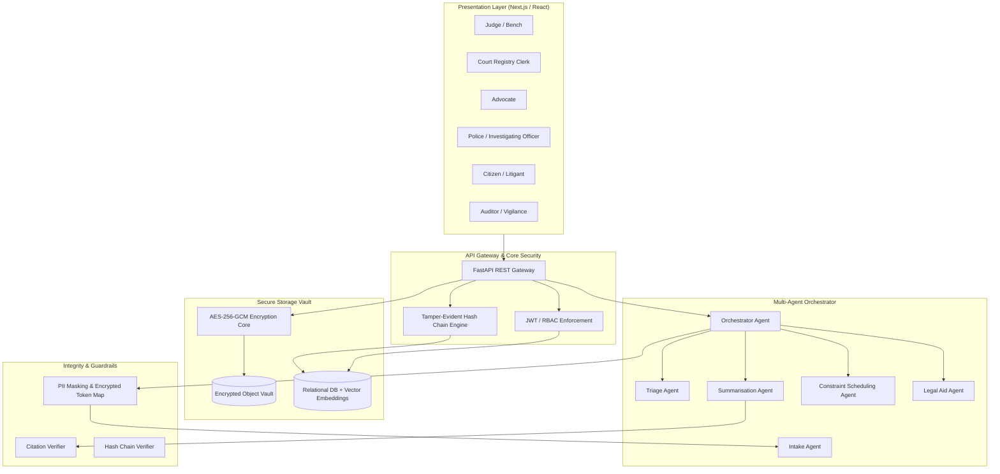

# NyayaFlow Architecture Documentation

## 1. High-Level System Architecture

NyayaFlow is built on two interdependent layers designed for strict judicial integrity and operational acceleration:

## 2. Multi-Agent Pipeline Specifications

1. **Intake Agent:** Scans case documents, extracts legal acts & sections (BNS, IPC, CrPC, BNSS), identifies parties, and classifies document types.
2. **Triage Agent:** Transparent rule scoring (0-100) prioritizing under-trial custody duration, statutory limitation deadlines, case age, and protected vulnerable parties.
3. **Summarisation Agent:** Generates 1-page bench briefs (<= 250 words), chronological timelines, and key issues with page/span source citations.
4. **Citation Verifier:** Validates every generated sentence against stored chunk excerpts to prevent hallucinations.
5. **Scheduling Agent:** CP-SAT constraint optimization allocating hearing slots while avoiding holidays and grouping related cases.
6. **Legal Aid Agent:** Multilingual citizen interface providing NALSA/DLSA guidance and automated Section 12 eligibility checks.
